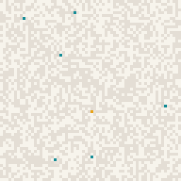

# Neural Cellular Automata: growth, repair, networks, and a chaos agent

**[Live demo on Hugging Face](https://huggingface.co/spaces/itstheryguy/growing-nca)** (runs in your browser, no install)

A Neural Cellular Automaton (NCA) is one small neural network that every pixel of a grid runs. Each cell sees only
its 3×3 neighborhood, yet together the cells grow an image, keep it stable, and repair damage. This project
reimplements two published NCA models in PyTorch. It then extends them in two directions of its own: an adversarial
"chaos agent" the models are trained against, and a network-building task trained with a differentiable
shortest-path loss. All five models run live in the browser through a numpy port of the model.

<p>



</p>

## Highlights

- **A network task with a differentiable loss for "connect everything cheaply".** Cells must link a random hub to
  3-6 targets, after the slime mold *Physarum polycephalum*, which redrew the Tokyo rail network
  ([Tero et al., 2010](https://www.science.org/doi/10.1126/science.1177894)). The loss unrolls a shortest-path
  computation in PyTorch, so gradients reach the cells on each target's best route. On 256 unseen layouts, the
  model connects every target in 69% of layouts (86% of all targets), using a network only 1.03× the size of a
  minimum spanning tree, and reconnects after damage 89% of the time.
- **A stochastic adversary, tuned with Monte Carlo.** The chaos agent is a cellular process driven by dice tables:
  agents spread, die, freeze, sabotage each other, and fight the NCA for cells. Batched simulations in PyTorch
  (128 games at a time) mapped how each rule changes the outcome before any model was trained against it. After a
  brushfire, a mountain model fine-tuned against the agent keeps more than twice as much of its image as the base
  model (median integrity 0.80 vs. 0.37).
- **Serverless deployment.** The Space is a static page that runs Streamlit on WebAssembly
  ([stlite](https://github.com/whitphx/stlite)). PyTorch isn't available there, so the forward pass is ported to
  numpy and checked against PyTorch by parity tests. A sparse update that only evaluates cells that can still
  matter made a step about 7× faster (45 ms to 6 ms).

## Models and results

| Model | What it does | Result |
|---|---|---|
| `mountain` | Grows the 🏔️ emoji from one cell and regrows damage. Reimplements [Growing NCA](https://distill.pub/2020/growing-ca/) (Mordvintsev et al., 2020). | Loss 0.0034 after 8,000 iterations (50 min on an M1 Pro); stable for 2,000+ steps |
| `texture` | Grows a topographic contour-map texture on a wrapping grid, trained with a VGG16 style loss. Reimplements [Self-Organising Textures](https://distill.pub/selforg/2021/textures/) (Niklasson et al., 2021). | 6,000 iterations (~10 min on an A100). Learns the contour lines but not yet the color bands |
| `mountain_chaos` | `mountain` fine-tuned while the chaos agent attacks it | v1.1 vs. the base model: brushfire median integrity 0.80 vs. 0.37, survival 51% vs. 45%; even against smolder and wildfire; slightly hazier without chaos (error 0.007 vs. 0.003) |
| `texture_chaos` | `texture` fine-tuned against the chaos agent | Repairs around chaos cells. Monte Carlo showed the outcome on a texture doesn't depend on the model (every cell defends), so training can't change who wins |
| `network` | Connects a random hub to 3-6 targets with as little network as possible | See Highlights. Median 95 steps to connect every target |

## How it works

**The NCA.** Each cell holds 16 numbers (12 for the texture): a few visible channels and the rest hidden "chemical"
state. Every step, each cell sees its own state plus Sobel gradients of its neighborhood (48 numbers), passes them
through a shared two-layer MLP (48 → 128 → 16, as 1×1 convolutions), and adds the result to its state. Only a random half of the
cells update each step, so there's no global clock. The model trains on a pool of past states, some of them
damaged, so the rule learns to persist and repair, not just to grow once.

**The network loss.** The cost of stepping into a cell is 1 inside the network and 30 in empty space,
interpolated by network density. The route cost from the hub to every cell comes from 128 rounds of min-plus
relaxation (`D = min(D, neighbor D + cost)`), unrolled so autograd can see it. The loss is the route cost summed
over targets, plus a material cost for each network cell. Material cost is what makes shared trunks worth it, so
the best answer is a Steiner-like tree, not a star of separate spokes. The material cost ramps in during training:
the cells explore first, then prune, as the slime mold does.

**The chaos agent.** Cells are NCA, active agents (red), dead agents (black), or frozen (blue). Each tick, every
active agent rolls 0-99 on a preset table: die, spread to the nearest 1-40 cells, spawn elsewhere, or sabotage its
neighbors. Dead agents return to the NCA or freeze. The NCA reclaims chaos cells next to its living cells. During
training, chaos ticks run without gradients, and their effects are applied with `torch.where`, so the gradient still
flows through the cells the NCA keeps.

## What I learned

Most of the work was in diagnosing why a run didn't learn. A few examples:

- **A dead channel from a clamp.** The network channel never received a gradient. Every cell starts at exactly 0,
  and `torch.clamp` passes zero gradient at its boundary. A leaky density (slope 0.05 below 0) fixed it.
- **A NaN from the opposite fix.** Passing the gradient straight through above 1 blew up instead: denser always
  looks cheaper to route through, so full cells kept climbing. The final density clamps above 1 and leaks below 0.
- **A cold start.** With the full material cost from step 0, growing anything cost more than it saved, and the
  model learned to grow nothing. Ramping the material cost in (explore, then prune) fixed it.
- **Near misses.** Network v1 often stopped one or two cells short of a target, because a gap cost only 10× a
  network cell. Raising that to 30× took fully connected layouts from 27% to 69% and the network size from 1.53× to
  1.03× the spanning tree.
- **A fine-tune that made things worse.** `mountain_chaos` v1 lost to the base model on every measure. During
  training, failed chaos attacks planted new NCA seeds, which grew extra mountains, and the loss punished those.
  v1.1 turned the seeds off during training, kept half the iterations chaos-free, and lowered the learning rate.
- **Phase transitions.** Monte Carlo showed the game is nearly all-or-nothing: chaos either fizzles early or takes
  the grid, and closely contested games stay at 0-4% even after rule changes meant to balance it. A small
  supercritical branching process behaves this way, and it changed which training measures were worth reporting.

## Repository layout

| Path | What |
|---|---|
| `nca.py` | Model (`CAModel`, configured by `CAConfig`), seeds, targets, damage, weight export |
| `network.py` | Network task in PyTorch: layouts, input clamping, differentiable route cost, connectivity |
| `chaos.py` | Batched chaos agent in PyTorch, for training |
| `train.py` | Experiment configs and the pool training loop (pixel, VGG style, and network losses) |
| `train.ipynb` | Training driver: runs locally (MPS) or on Colab (CUDA), with a live flipbook |
| `space/` | The Space: `app.py` (Streamlit), numpy ports (`nca_numpy.py`, `chaos_numpy.py`, `network_numpy.py`), chaos presets, `index.html` (stlite), `models/*.npz` |
| `tests/` | Parity tests: numpy vs. PyTorch for every model type and for the chaos agent (with replayed random draws) |
| `tools/montecarlo.py` | Batched Monte Carlo games of an NCA against the chaos agent |
| `tools/make_topo_texture.py` | Generates the contour-map texture target |
| `runs/` | Training loss logs |

## Reproduce

```sh
pip install torch torchvision numpy matplotlib jupyter   # global
python -m venv --system-site-packages .venv             # sees the global packages
.venv/bin/pip install pillow streamlit
.venv/bin/python tests/test_parity.py                   # parity tests (also run under pytest)
.venv/bin/python tests/test_chaos_parity.py
```

**Train:** set `EXPERIMENT` in `train.ipynb` and run all cells. Locally (MPS), `mountain` takes about 50 minutes on an
M1 Pro. On Colab, pick a GPU runtime: the notebook clones this repo, trains, and pushes the weights, GIF, and loss log
to a `run/<experiment>-<time>` branch. Pushing needs a GitHub fine-grained token with *Contents: read and write*,
from the Colab secret `GH_TOKEN` or pasted when asked.

**Monte Carlo:** `python tools/montecarlo.py mountain --presets brushfire smolder wildfire --n 128`

**Run the Space locally:**

```sh
.venv/bin/streamlit run space/app.py      # as a normal Streamlit app
python -m http.server -d space 8000       # as the static stlite page, at localhost:8000
```

**Deploy:** `hf upload itstheryguy/growing-nca space . --repo-type space --exclude "__pycache__/*"`

## Credits and license

Code: MIT License (see `LICENSE`). Emoji images in `data/`: [Noto Emoji](https://github.com/googlefonts/noto-emoji)
by Google, Apache License 2.0. NCA architecture and training method from Mordvintsev et al. (2020) and Niklasson et
al. (2021).
