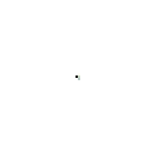

# Growing NCA: a mountain from one cell

A PyTorch Neural Cellular Automaton that grows the 🏔️ emoji from a single seed cell, keeps it stable, and regrows
it after damage, after [Growing Neural Cellular Automata](https://distill.pub/2020/growing-ca/) (Mordvintsev et
al., 2020). Deployed as a static Hugging Face Space that runs in the browser with stlite.



Growing from one cell, then cut in half at step 300 and regrowing. 8,000 training iterations (50 minutes on an
M1 Pro), final loss 0.0034; stable through at least 2,000 steps.

| Path | What |
|---|---|
| `nca.py` | Model (`CAModel`), seed, target loading, damage, weight export |
| `train.ipynb` | Training loop with sample pool, damage, and live flipbook |
| `space/` | The Space: `app.py` (Streamlit), `nca_numpy.py` (numpy port of the model), `index.html` (stlite) |
| `peek.py` | Progress and a preview image during a training run |
| `tests/test_parity.py` | Checks the numpy port matches PyTorch |
| `data/` | Noto Emoji mountain PNGs (Apache 2.0) |

## Setup

```sh
pip install torch numpy matplotlib jupyter          # global
python -m venv --system-site-packages .venv          # sees the global packages
.venv/bin/pip install pillow streamlit
```

## Train

Open `train.ipynb` with the `.venv` interpreter and run all cells (about 50 minutes for 8,000 iterations on an M1
Pro with MPS). Or headless: `.venv/bin/python -m jupyter nbconvert --execute --inplace train.ipynb`.
Set `NCA_ITERS` to change the iteration count. It writes `models/nca_mountain.pth` and `space/nca_mountain.npz`.

During a headless run, `python peek.py` prints progress and saves `checkpoints/peek.png`, a preview grown from the
latest checkpoint (including a cut-in-half regrowth test). `python peek.py --watch` keeps a live progress bar.

## Run the Space locally

```sh
.venv/bin/streamlit run space/app.py                 # as a normal Streamlit app
python -m http.server -d space 8000                  # as the static stlite page, at localhost:8000
```

## Deploy

```sh
hf upload <user>/growing-nca space . --repo-type space --exclude "__pycache__/*"
```

## Differences from the original paper

- 44 px emoji on a 64 px grid (the paper: 40 px on 72 px).
- Fused depthwise perception conv (one grouped `conv2d`), about 13% faster on MPS.
